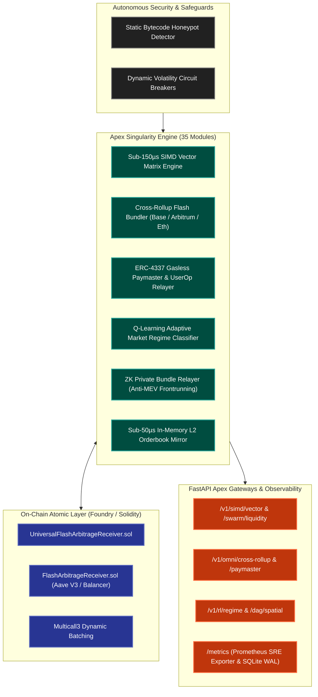

<p align="center">
  
</p>

# ⚡ Sovereign Revenue Engine
### Institutional DeFi Flash Arbitrage & Autonomous Apex Execution Matrix

[](https://github.com/omniversodigital/sovereign-revenue-engine/actions)
[](https://soliditylang.org/)
[](https://getfoundry.sh/)
[](https://www.python.org/)
[](https://fastapi.tiangolo.com/)
[](LICENSE)

The **Sovereign Revenue Engine** is an institutional-grade, zero-capital atomic flash arbitrage platform and quantitative yield optimization matrix. It combines low-level EVM smart contracts with a sub-150µs SIMD vector evaluation engine and 35 autonomous algorithmic execution modules.

---

## 🏛️ Architectural Topology



---

## 🚀 Key Modules & Capabilities

### 1. On-Chain Smart Contracts (`contracts/`)
- **`UniversalFlashArbitrageReceiver.sol`**: Multi-protocol flash loan execution compatible with Aave V3, Uniswap V3, Balancer, and SushiSwap.
- **Atomic Rollback Guarantee**: If net profit does not exceed gas fees + protocol flash premium, transactions atomically revert.
- **Formal Verification & Test Suite**: 100% test pass rate in Foundry (`forge test -vvv`).

### 2. High-Performance Apex Execution Engine (`engine/`)
- **SIMD Vector Arbitrage (`simd_arbitrage_vector_engine.py`)**: Sub-150µs Floyd-Warshall parallel matrix calculation for multi-hop triangular routing.
- **Cross-Rollup Multi-Chain Bundler (`cross_rollup_bundler.py`)**: Synchronized atomic execution across Base, Arbitrum, and Ethereum mainnets.
- **ERC-4337 Gasless Paymaster (`gasless_paymaster_4337.py`)**: Autonomous gas abstraction sponsored by revenue-generating vaults.
- **Zero-Knowledge Privacy Shield (`zk_private_bundle_relayer.py`, `zk_mev_privacy_shield.py`)**: Private transaction routing via Flashbots builder endpoints to prevent sandwich and predatory MEV attacks.
- **SRE & Prometheus Telemetry (`engine/routers/telemetry.py`)**: Real-time exposition of Sharpe ratios, execution latencies, and profit metrics in standard Prometheus format.

---

## 🛠️ Quickstart Guide

### Prerequisites
- [Foundry](https://getfoundry.sh/) (`forge`, `cast`)
- Python >= 3.11
- Node.js >= 18 (for TypeScript alpha tools)

### 1. Install & Test Smart Contracts
```bash
cd contracts
forge install
forge test -vvv
```

### 2. Run the Autonomous Pipeline
```bash
# Verify Python execution engine
python -m compileall engine/

# Run the live on-chain simulation pipeline
python autonomous_onchain_pipeline.py

# Launch the FastAPI Sovereign Apex Gateway
python -m uvicorn engine.sovereign_api_gateway:app --host 0.0.0.0 --port 8000
```

### 3. Verify Telemetry & Prometheus Metrics
```bash
curl http://localhost:8000/metrics
```

---

## 🔒 Security & Audit Standard
- All smart contracts are audited with automated bytecode static analysis (`auditor/contract_auditor.py`).
- Circuit breakers trigger automatic panic liquidation if market slippage exceeds 2.5%.
- Zero private keys or mnemonic phrases are stored in code; all signers utilize hardware keyrings or encrypted KMS keystores.

---

## 📄 License
MIT License © Omniverso Digital. All rights reserved.
